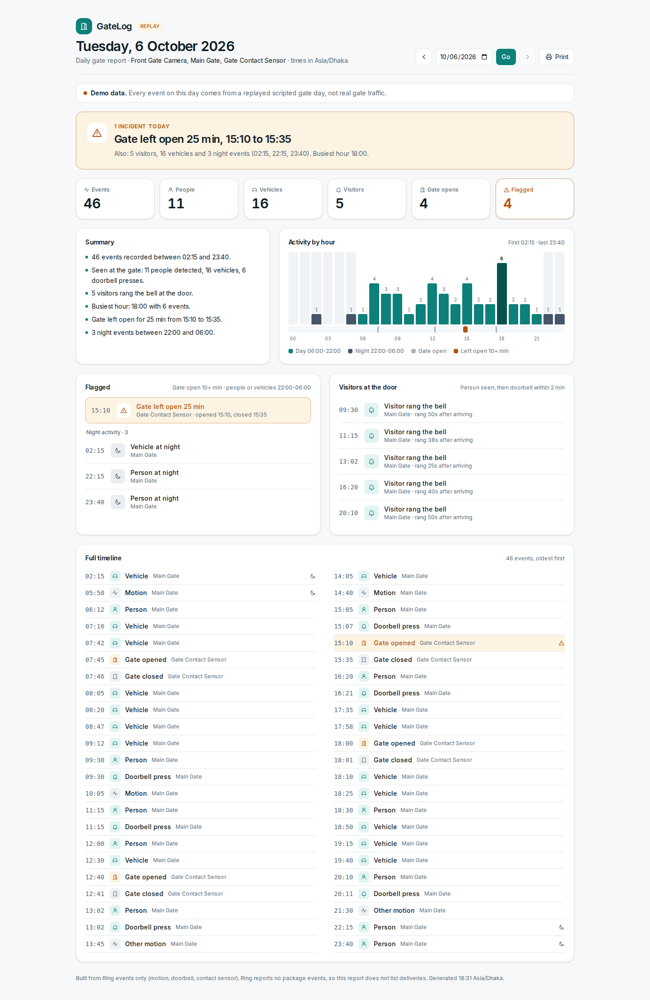

# GateLog

Entry for the Ring track of [Build, Ship, Shape: Amazon Developer Hackathon](https://amazonappdev2026.devpost.com/).

**Idea:** an event log for a gate (housing society, office). Ring camera events (motion, package,
vehicle, doorbell press) become a daily report for the management committee: who came, when, what
was delivered. It reads events. It does not control locks, because the Ring API has no lock endpoint.

| | |
|---|---|
| Track | Ring (business systems / caretaking) |
| Deadline | Fri 23 Oct 2026 12:00 PDT = Sat 24 Oct 01:00 Dhaka. Internal wall: 21 Oct |
| Judging | Pass/fail viability, then 4 equal criteria. Friction log = up to +10% |
| Demo | Ring Playground simulator is allowed by the rules |
| Repo rule | Must call the Ring API at runtime. Public + licence, or private + shared with testing@devpost.com and 6 Amazon reviewers |

## Ring API facts we checked (Ring developer console, from 2026-09-29)

- Playground token: 30 min, scope `ava.v1:read` only. `GET api.amazonvision.com/v1/devices` returns 1 simulated device.
- Sandbox live-view sims: Package, Vehicle, Motion. `button_press` is in the docs but cannot be tested in the sandbox.
- No lock / access-control endpoint anywhere.
- Sandbox video: was black on most runs from about 15:30 to 16:15 UTC on 2026-09-29 (DELETE session and /metrics returned 503), reliable again from about 16:20 UTC - cause unknown: a temporary Ring-side fault, or stale page state cleared by a reload. Not a per-token rule. When recording: reload, fresh token, one clip per take. Credits (CC BY 4.0) if shown: Package = YouTube user frollard, Motion = Vimeo user Michael Black.
- Event History works in the sandbox: `GET /v1/history/devices/{id}/events` returns `history-events` (attributes, relationships, meta). Live run 2026-10-06: 14 `on_demand` (live-view) events, and every `event_types` filter returned the same 14 rows - the sandbox ignores the filter.
- Real event types (console session): webhook `motion_detected` (sub_type motion/human/vehicle/other_motion), `button_press`, `contact_sensor_faulted/cleared`. History: `GET /v1/history/devices/{id}/events?event_types=ding,motion.vehicle`. There is NO package event in the API docs.
- Calls must be server-to-server (CORS blocks browsers).
- Real app tokens (access ~4h, refresh ~30d) need Create app: 4 HTTPS endpoints, privacy policy, ToS, ID verification. Skipped unless needed.
- Sample: github.com/AmazonAppDev/ring-api-helloworld (Next.js 15 + Python).

## Run it

Needs bun 1.4+ (and Node 24 for Next.js).

```
bun install
cp .env.example .env.local          # RING_MODE=replay works with no token
bun run build
RING_WEBHOOK_SECRET=demo-local-secret bun run start -p 3100
# second terminal: send one scripted gate day through the signed webhook
RING_WEBHOOK_SECRET=demo-local-secret bun run replay:day -- --day 2026-10-06 --url http://localhost:3100/api/ring/webhook
# open http://localhost:3100/?day=2026-10-06
```

- `RING_MODE=live` + `RING_TOKEN=<Playground token>` calls the real Ring API (`/v1/devices`, `/v1/history/devices/{id}/events`).
- `RING_MODE=record` does the same and saves each response to `fixtures/recorded/`, so `replay` can run later with no token.
- `POST /api/ring/webhook` takes Ring webhook payloads, checks `X-Signature` (HMAC-SHA256 of the raw body). `POST /api/ring/sync` pulls event history (needs `x-sync-key` in production).
- Replayed demo events are tagged `replay` and the page says "Demo data" - they are never shown as real gate traffic.
- Tests: `bun test`. Plan: `docs/PLAN.md`. Ring API facts: `docs/ring-api-spec.md`.
- Demo video: made with [video-kit](https://github.com/joyahmed/video-kit) (open source, MIT) from `video/shots.mjs`.



## Status

- 2026-10-06: Gate 2 loop works with replayed data: event -> signed webhook -> store -> report on screen. 70 tests pass.
- 2026-10-06: live sandbox run done (1 device, 14 real events), real responses saved in `fixtures/recorded/`. Sandbox ignores `event_types` - handled.
- 2026-10-06: demo video v1 cut (1:45, captions only), kept outside the repo in `../ring-gatelog-video/`. Open: voice or captions, Open Source vs AWS Builder mini.

Friction log: `docs/friction-log.md`. The earlier AWS CDS idea was dropped (needs a registered company and a Facebook business profile).
