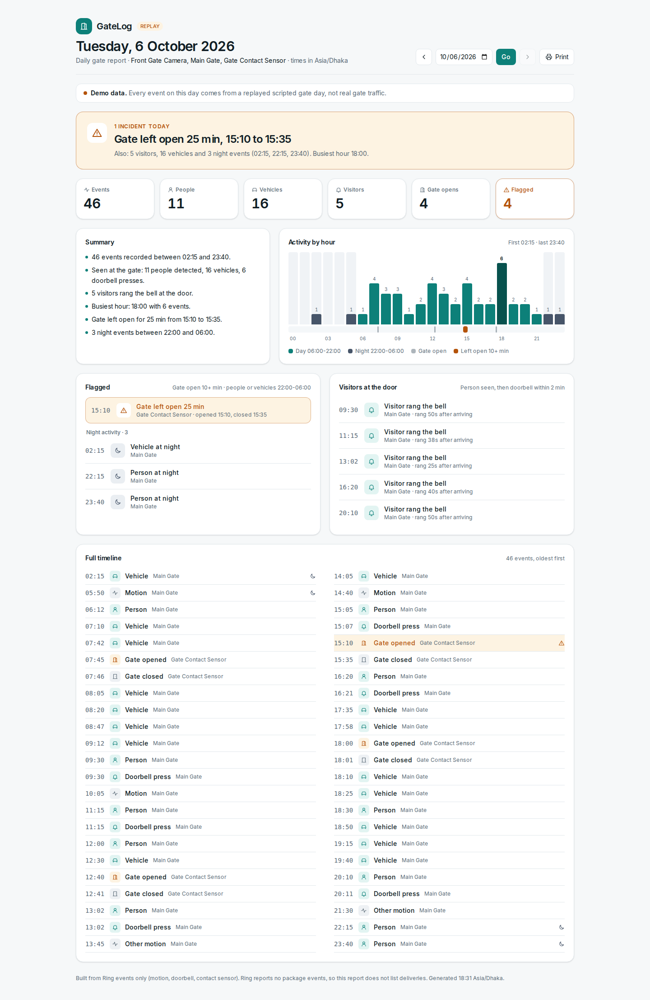
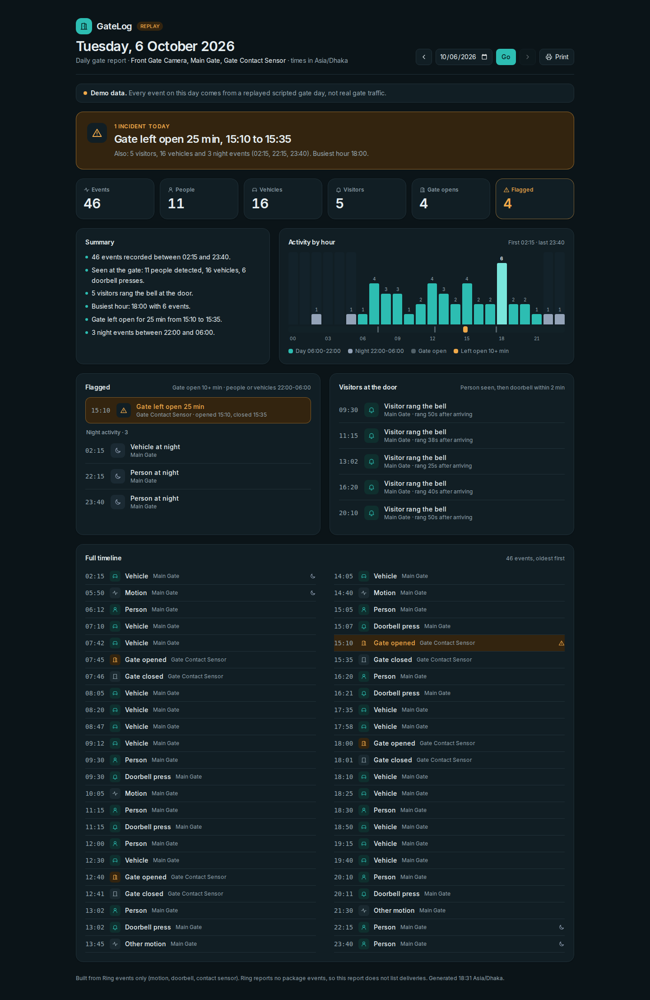
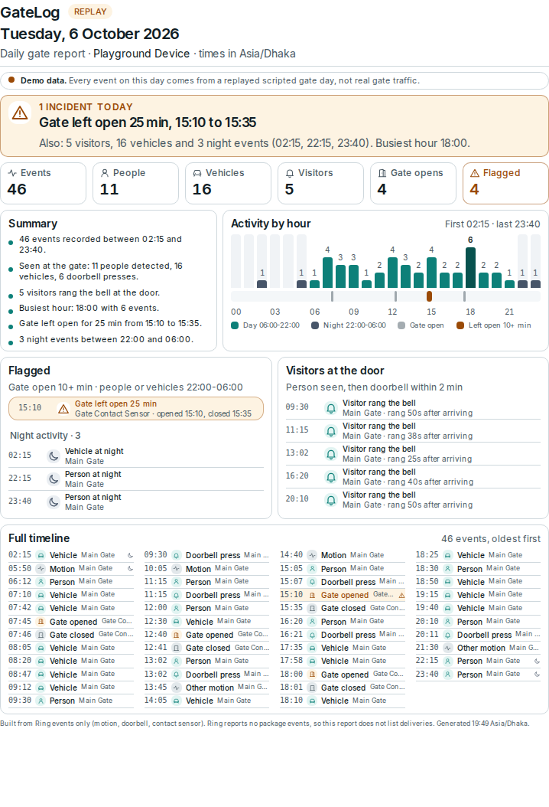
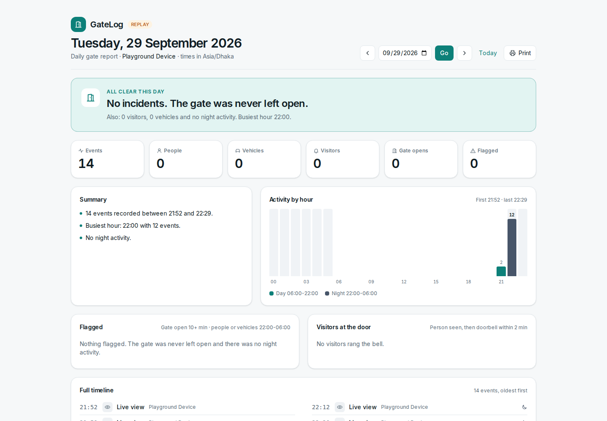

<div align="center">

# GateLog

**A daily gate report built from Ring camera events.**<br>
Who came to the gate, when, and whether it was left open, on one page you can print.

[](https://amazonappdev2026.devpost.com/) [](#run-it) [](LICENSE)

### [▶ Watch the demo](https://youtu.be/vSqTdbO6Nyo)

Free · No database · Next.js 16 + TypeScript + Tailwind 4

<br>



</div>

<br>

> **Hackathon entry.** I built it in October 2026 for the Ring track of [Build, Ship, Shape: Amazon Developer Hackathon](https://amazonappdev2026.devpost.com/). It works end to end, but it's a demo, not a finished product. The day in the screenshot is scripted demo data, and the page says so.

## Why I built this

A housing society or an office has a gate, and a management committee that wants to know what happened at it. Who came, when, and was the gate left open at night.

A Ring camera already sees all of that. So I took its events (motion, people, vehicles, doorbell presses, the gate sensor) and turned them into one daily report the committee can read or print.

It only reads events. It doesn't open or lock anything, because the Ring API has no lock endpoint. And Ring reports no package events, so the report never claims a delivery.

## A quick look

<table>
  <tr>
    <td width="50%" valign="top">
      <br>
      <b>Light and dark.</b> The same report in both themes, and it fits a phone screen too.
    </td>
    <td width="50%" valign="top">
      <br>
      <b>Prints on A4.</b> One button, ready for the committee meeting.
    </td>
  </tr>
  <tr>
    <td colspan="2" valign="top">
      <br>
      <b>Real Ring data.</b> A day pulled live from the Ring API sandbox.
    </td>
  </tr>
</table>

## Highlights

- 🚪 **Gate left open**: flags the gate when it stays open 10 minutes or more.
- 🔔 **Visitors**: a person seen, then the doorbell pressed within 2 minutes, counts as a visitor at the door.
- 🌙 **Night activity**: any person or vehicle between 22:00 and 06:00 is flagged.
- 📊 **One page per day**: counts, an hourly chart, flagged events and the full timeline. Pick any date.
- 🔐 **Signed webhook**: Ring webhooks are checked with HMAC-SHA256 before they are stored.
- 🏷️ **Honest about demo data**: replayed events are tagged, and the page says "Demo data" so they are never shown as real traffic.
- 🖨️ **Print**: one click, laid out for A4.
- 📱 **Any screen**: checked at 390 px and 1440 px, in light and dark.

## Run it

You need Bun 1.4+ and Node 24.

```
bun install
cp .env.example .env.local          # RING_MODE=replay works with no token
bun run build
RING_WEBHOOK_SECRET=demo-local-secret bun run start -p 3100

# second terminal: send one scripted gate day through the signed webhook
RING_WEBHOOK_SECRET=demo-local-secret bun run replay:day -- --day 2026-10-06 --url http://localhost:3100/api/ring/webhook

# then open http://localhost:3100/?day=2026-10-06
```

Three modes, set with `RING_MODE`:

| Mode | What it does |
|---|---|
| `replay` | Uses saved responses. No token needed. |
| `live` | Calls the real Ring API (`/v1/devices`, `/v1/history/devices/{id}/events`). Needs `RING_TOKEN`. |
| `record` | Same as `live`, and saves each response to `fixtures/recorded/` so `replay` can use it later. |

Two endpoints:

- `POST /api/ring/webhook` takes Ring webhook payloads and checks the `X-Signature` header.
- `POST /api/ring/sync` pulls event history from Ring. In production it needs the `x-sync-key` header.

Tests: `bun test`.

## Watch it

The demo video is a real screen recording: a clip played on the Ring Playground camera shows up as a new row in GateLog, pulled from the Ring API: [youtu.be/vSqTdbO6Nyo](https://youtu.be/vSqTdbO6Nyo). More of what I build: [youtube.com/@joysbuilds](https://www.youtube.com/@joysbuilds).

## What I learned about the Ring API

<details>
<summary><b>Notes from building against the sandbox</b> (click to open)</summary>

- A Playground token lasts 30 minutes, with read-only scope. `GET /v1/devices` returns one simulated device.
- Calls must go server to server. CORS blocks them from a browser.
- Event history works in the sandbox, but it ignores the `event_types` filter: every filter returned the same rows. GateLog handles that.
- Real event types: `motion_detected` (person, vehicle, other motion), `button_press`, and the contact sensor's `faulted` / `cleared`. There is no package event.
- There is no lock or access-control endpoint anywhere.
- The sandbox's live-view video was black for a while on one evening, then reliable again. Cause unknown.

The full notes are in [docs/ring-api-spec.md](docs/ring-api-spec.md), and every snag I hit is in the [friction log](docs/friction-log.md). The build plan is in [docs/PLAN.md](docs/PLAN.md).

</details>

## License

MIT. See [LICENSE](LICENSE).

---

<div align="center">

I build tools I use myself, from Bangladesh. This one started as a hackathon entry, and I'd love to see it guard a real gate.<br>
Found a bug or want something? [Open an issue](https://github.com/joyahmed/ring-gatelog/issues).

**Joy**

</div>
